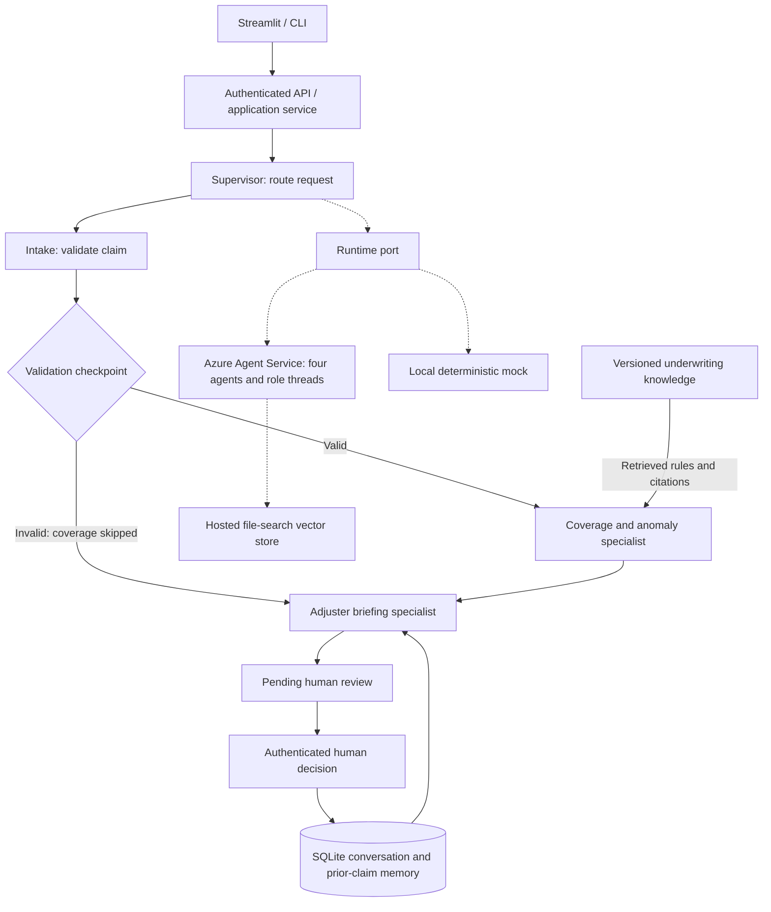

# 2. Architecture



Solid arrows show the application workflow. Dotted arrows show runtime choices and Azure resources; the runtime port serves all four agent roles. Azure resources are created by the provisioning command, not by starting the local demo.

```text
Synthetic JSON/CSV ── CLI / authenticated FastAPI ── Supervisor application service
                                                      │
                  SESSION → INTAKE → VALIDATE → VALIDATION_CHECKPOINT
                                                      │
                      COVERAGE_AND_ANOMALIES → BRIEF → HUMAN_REVIEW_PENDING
                                                      │
                                             adjuster's recorded decision
                                                      ▼
                                                REVIEWED / FAILED

Supervisor ── AgentRuntime port ── MockRuntime (default)
                             └── AzureRuntime → Foundry Agent Service
                                   ├── Supervisor + route_request tool
                                   ├── Intake + validate_claim tool
                                   ├── Coverage + check_coverage / search_knowledge tools
                                   └── Briefing + build_brief tool

Domain validation / coverage / briefing ← retrieved structured underwriting records
Application service → Repository port → SQLite (sessions, messages, batches,
    results, events, human reviews, policy history, Azure threads, deployment manifest)
Coverage retrieval → local vector search over versioned knowledge files
Azure Coverage agent → hosted FileSearchTool over uploaded underwriting markdown
```

The application owns step ordering, authorization, state transitions, and validated tool context. Agents receive only the tools allowed for their role. Azure model calls request an appropriate function and the application executes its schema-validated, context-bound operation. Deterministic domain outputs govern recommendations; model text is supplemental and never overrides validation or a human gate. The default runtime executes the same tools without network calls. The Azure runtime retains separate threads for each role in a session to avoid cross-agent instructions and concurrent-run conflicts.

Domain modules have no Azure, HTTP, or persistence dependencies. Protocols define repository and runtime boundaries; adapters implement them. The composition root injects the catalog, retrieval source, repository, and runtime. Monetary values use Decimal; no floating point limit decisions. Retrieval returns rule IDs, source filenames, excerpts, and a knowledge version hash. Rule thresholds and mappings reside in data files, while generic evaluators implement their operators.

SQLite transactions commit an entire batch, its history and audit trail together. Token-fenced SQLite session leases serialize conversation changes across local CLI/API processes; a stale lease owner cannot renew or commit a batch. Leases renew between agent steps and expire after ten minutes if a process dies. History only includes earlier loss dates and excludes the current claim. Human review is a compare-and-set transaction and can be recorded only once per row. Invalid intake requires more documentation; coverage or anomaly findings require investigation. Every recommendation is initially pending human review; approval is allowed only on clean evidence.

Security: require a configured long random bearer token for the single-tenant HTTP service, constant-time comparison, no public data endpoints, bounded inputs, parameterized SQL, opaque IDs, exact tool allowlists, no tool-controlled filesystem or SQL, no model-triggered approval tools, and Entra `DefaultAzureCredential` for Foundry. Descriptions, documents, model messages and tool arguments are untrusted. A declaration is a workflow guard, not a technical PII detector. Deploy only synthetic datasets; real insurance processing is outside this assignment. TLS, secret storage, disk encryption and restricted ingress belong to the deployment boundary. Multi-tenant identity and per-user RBAC are future scope.

Errors use stable codes with sanitized HTTP messages. Invalid individual rows do not reject a whole validly shaped batch. Invalid file/envelope input does. Agent errors preserve deterministic findings and add an explicit service issue, force documentation review, and are audited; no hidden change from Azure to mock. Missing knowledge or corrupt policy configuration stops initialization, rather than assuming coverage. Polling and tool-call counts are bounded, and timed-out Azure runs are cancelled best-effort.

Structured JSON logs contain event, agent, tool, session/batch correlation and error class, never raw descriptions, API tokens or tool payloads. Persisted evidence and events support explanations and review. Local logs are suitable for collection by Azure Monitor; native OpenTelemetry export is optional and not claimed as delivered. See deployment documentation for operational limits and backups.
