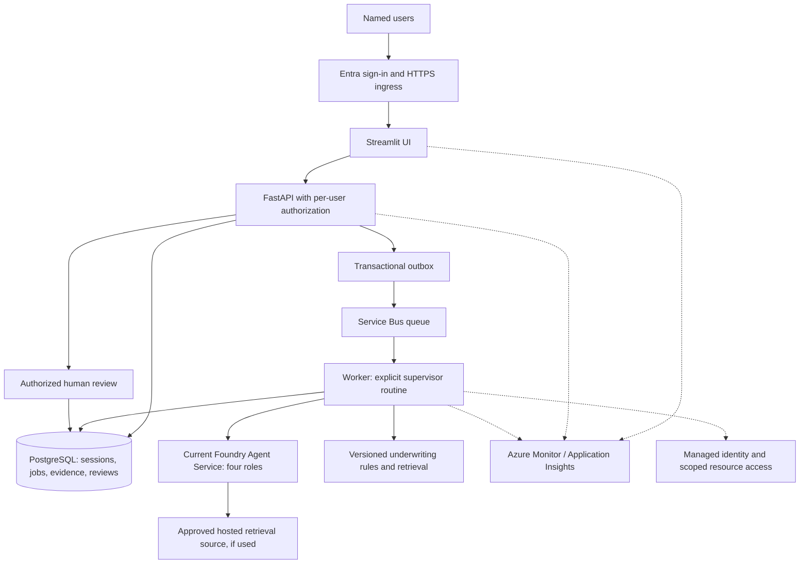

# Production-readiness roadmap and implementation guide

Planning baseline: **10 October 2026**. This is a plan for work that remains; it does not claim that the proposed components have been implemented or deployed.

## 1. What the supplied requirements actually require

[projectdetails.txt](../projectdetails.txt) asks for a supervisor and three specialists, programmatic Azure agent creation, schema-defined tools, retrieval grounding, conversation and persistent memory, an explicit routine with human checkpoints, failure handling and basic observability. It explicitly requires synthetic data and permits mocked LLM calls when Azure access or quota is unavailable, provided the SDK integration remains in code and the limitation is explained.

The current implementation covers those application behaviors locally. The most important remaining assignment evidence is **successful live execution against a supported Foundry environment**. Adding Foundry credentials alone does not establish production readiness. The opening phrase about production solutions should be supported by operational evidence, not interpreted as permission to process real claims.

Enterprise identity, high availability, distributed workers, retention automation and disaster recovery are additional deployment requirements. They are useful extensions, but are not all explicit acceptance criteria in the supplied assignment. Streamlit is also an addition rather than an original requirement.

Recommended order: complete the supported Foundry integration and live acceptance first, then harden a defined internal deployment. Retain the existing domain rules, human gates and local mock mode for reproducible testing.

## 2. Current position and concrete gaps

The recorded full local run has **237 passing tests, one skipped live Azure test and 95.32% statement coverage**. Lint, type checking, dependency consistency, and real HTTP/Streamlit smoke checks passed. These are application results, not model-quality or availability measurements. See [verification evidence](verification.json) and the [requirement mapping](11-coverage.md).

| Area | Existing implementation | Pending evidence or work |
|---|---|---|
| Four roles and tools | Supervisor, intake, coverage and briefing; five custom function schemas in [tools.py](../src/claims_triage/tools.py) | Create and invoke all four roles in the target Azure environment |
| Azure runtime | Pinned `azure-ai-agents==1.1.0`; classic agents, threads and runs in [azure_runtime.py](../src/claims_triage/azure_runtime.py) | Migrate for a new production deployment; verify supported model/tool combination |
| Grounding | Versioned local TF-IDF retrieval and rule citations; classic hosted file-search registration | Prove live grounding; inspect hosted search execution separately if claiming it |
| Memory | SQLite messages, previous-claim history and per-role remote thread IDs | Migrate remote identifiers; preserve restart behavior; scope records to authorized users/teams |
| Human review | Deterministic recommendations, pending review and unsafe-approval rejection | Individual identity, roles, authorized record access and attributable review audit |
| Model output | Supplemental narrative collected by the Azure adapter; application returns deterministic tool evidence | Decide whether model prose is needed; validate it before exposing it. This is optional, not an assignment blocker |
| Storage and concurrency | Transactions and fenced session leases on one local SQLite host | Shared database and durable jobs for a replicated deployment; cross-session policy-history consistency |
| Hosting | API Dockerfile and single-host Compose configuration | Build/run image, host behind authenticated TLS ingress, prove restart/persistence and rollback |
| UI | Local Streamlit launcher with a shared server-side API token | Separate UI deployment artifact and user identity propagation; current Dockerfile serves the API only |
| CI | Python 3.11-3.13 test matrix and container build job | Last remote attempt was prevented by an account-level runner restriction; restore execution and obtain passing evidence |
| Operations | Structured logs and persisted routine events | Traces, alerts, cost/latency metrics, retention, recovery drills and operational ownership |

The existing [live test](../tests/test_live_azure.py) exercises **one starter claim** and a follow-up. It does not prove the entire four-claim batch, hosted search execution, production identity, load capacity or recovery.

## 3. First priority: choose the supported Foundry API

Microsoft documents classic agents as deprecated with retirement on **March 31, 2027**. Its classic sample explicitly lists `azure-ai-agents==1.1.0`, matching this repository's adapter. The recommendation for a new production implementation is therefore to migrate, not build a long-lived deployment around the current classic adapter. [Microsoft lifecycle notice](https://learn.microsoft.com/en-us/azure/foundry-classic/agents/how-to/tools-classic/azure-ai-search-samples).

The current developer experience uses agent versions, conversations and responses. Migration requires changes to tool handling and persisted state as well as imports; old thread/run state is not automatically transferred by the migration tool. Follow [Microsoft's migration guide](https://learn.microsoft.com/en-us/azure/foundry/agents/how-to/migrate?view=foundry).

For a short assignment demonstration, the existing adapter could be tested only if the selected project still supports the classic contract. That is a compatibility experiment, not the recommended production destination. Recheck lifecycle, regional availability, tool support and package versions when implementation starts.

## 4. How long it will take

These are **engineering estimates for this repository**, not Microsoft commitments or guarantees. Assumptions: one experienced Python/Azure engineer, about six focused engineering hours per working day, five working days per week, timely access to an Azure/platform reviewer, one organization, synthetic data, and reuse of the existing implementation. Access approvals, quota requests and account restrictions can add calendar time independently of coding effort.

| Target | Estimated effort from the current baseline | What can be claimed after acceptance |
|---|---|---|
| Supported Foundry demonstration | 7-12 working days, roughly 1.5-2.5 weeks | Live Azure-backed application with tested four-role workflow, retrieval and memory |
| Restricted internal pilot | About 20-30 working days, roughly 4-6 weeks, cumulative | Controlled synthetic-data pilot with named users, secure hosting, persistence and basic operations; a restricted single-host option can defer distributed processing |
| Production readiness for the defined internal scope | About 39-60 working days including contingency, roughly 8-12 weeks, cumulative | A production release candidate that has passed the gates below; launch still depends on owner acceptance |
| Actual insurance operations with real customer data | Separate discovery and estimate; potentially months beyond the above | Requires authorized data scope, policy-system integration, domain validation and organizational approval |

These estimates are not additive. The phase backlog below totals **31-48 engineering days before contingency**; adding approximately 25% gives 39-60 days. The internal-pilot estimate delivers a narrower operating scope and can defer some production work. For someone learning Azure and identity/database operations during delivery, allow roughly 1.5-2 times the effort. A second engineer can overlap work but does not remove access waits or release gates.

| Phase | Work | Engineering days | Dependencies |
|---|---|---:|---|
| P0 | Access, scope, quota, lifecycle decision and CI unblock | 1-2 | Project owner and subscription/platform owner |
| P1 | Current Foundry adapter and SDK contract migration | 4-7 | P0 |
| P2 | Expanded live acceptance and evidence | 2-3 | P1 |
| P3 | User authentication, authorization and audit identity | 3-5 | P0; can overlap P1 |
| P4 | Shared persistence, idempotency and durable processing | 6-9 | P3's ownership model; needed before scaling |
| P5 | Infrastructure as code, hosting and deployment pipeline | 3-5 | P1/P3; production topology depends on P4 |
| P6 | Operational telemetry and AI evaluation | 4-6 | P2 and deployable staging environment |
| P7 | Load, security, recovery and failure exercises | 6-8 | P3-P6 |
| P8 | Runbooks, acceptance, staged release and handover | 2-3 | All applicable gates |

An indicative schedule is weeks 1-2 for supported Azure execution, weeks 3-4 for identity/data/hosting, weeks 5-6 for jobs/telemetry/evaluation, weeks 7-8 for recovery and release exercises, and weeks 9-12 as integration/rework contingency. Re-estimate after P2 using measured Azure latency, error rates and the actual hosting constraints.

## 5. Target architecture

The following is a **proposed** Azure architecture for a replicated internal service. These resources are not currently deployed. A smaller pilot can use the single-host managed-disk pattern in the [deployment guide](09-deployment.md), with documented availability limits.



Container Apps is one possible UI/API/worker host after storage and job semantics are adapted. Keep PostgreSQL, broker and application access private as required by the chosen network design. Do not deploy several replicas of the current SQLite build or put its WAL database on a network file share. Do not add Kubernetes, multiple vector databases or multi-region failover without a workload requirement.

Managed identities can give Container Apps scoped access to compatible Azure services without embedded credentials. Authentication at ingress still needs application-level authorization. See [managed identities](https://learn.microsoft.com/en-us/azure/container-apps/managed-identity) and [Container Apps authentication](https://learn.microsoft.com/en-us/azure/container-apps/authentication).

## 6. Implementation sequence and acceptance checks

### P0 - Establish access and a release scope

Record the Azure subscription/project, region, model deployment, supported API/SDK versions, tool availability, identity owners and spending limit in private deployment configuration. Confirm access and quota before scheduling the live work. Resolve the GitHub runner restriction or use an organization-approved runner; do not claim remote checks passed until they run.

Agree the first release's users, expected concurrent handlers, typical/max batch size, availability objective, maximum tolerable data loss, recovery time and support owner. The current limit is 100 rows per batch, not a demonstrated capacity result. Retain synthetic-only input and human decision authority.

Acceptance: authenticated project access, supported model/tools, an agreed scope, and an executable CI runner. The absence of `azd` is not itself a blocker for this SDK-based application; choose one provisioning approach and document it.

### P1 - Migrate the runtime while preserving business behavior

Keep the [AgentRuntime port](../src/claims_triage/ports.py) and implement the current service behind it, initially in a new adapter such as `foundry_runtime.py`. The new filename is a proposal. Update [bootstrap.py](../src/claims_triage/bootstrap.py), [config.py](../src/claims_triage/config.py), [pyproject.toml](../pyproject.toml), lock files and [SDK contract tests](../tests/test_azure_runtime.py) together.

Map the four code-defined roles and tool schemas to current agent definitions. Replace classic thread/run operations with supported conversation/response operations. Persist role-specific conversation references and release-specific agent/version identifiers using a versioned schema. A classic ID must never be treated as a current conversation ID. For synthetic demonstration data, a fresh Azure profile is simpler than migrating remote historical conversations; retain local history separately.

Preserve role allowlists, exact context binding, tool-result authority, execution deadlines and explicit errors. Rework retries for the chosen API: retry only appropriate transient failures, honor service backoff, bound attempts, and reconcile ambiguous outcomes instead of creating duplicate conversations or remote executions. Do not simply install newer packages over the old adapter.

Acceptance: the original domain suite remains passing; new adapter tests cover tool results, identity/context violations, repeated calls, interruptions and restart behavior. Programmatic creation still yields four roles and at least the assignment's three schema-defined tools.

### P2 - Prove live behavior and grounding

Extend [test_live_azure.py](../tests/test_live_azure.py) beyond `rows[:1]`. Run all four starter claims, CSV input, a contextual follow-up, process restart, persistent earlier-history lookup, a safe human decision and rejected unsafe approval. Use a separate synthetic staging profile.

Preserve expected starter outcomes: C-2031 investigation, C-2032 approval recommendation pending human review, C-2033 investigation, C-2034 documentation request with coverage skipped. Capture agent/tool execution evidence, citations, knowledge version and absence of unexpected `service_issues`. Repeat the core flow to identify variability.

The assignment needs at least one real retrieval source; it does not require both local retrieval and Azure AI Search. The current local catalog satisfies the offline grounding design. If the release claims hosted file search, separately verify actual search execution and relevant returned evidence: resource registration and locally generated citations are insufficient. Keep mandatory policy checks independent of a top-k result accidentally omitting a rule.

After adapting the existing CLI and test to the chosen API, the intended acceptance entry points remain:

```powershell
# Configure the chosen project, model and identity as documented for the migrated adapter.
$env:TRIAGE_MODE = 'azure'
$env:TRIAGE_DATABASE = 'var/azure-staging.db'
.\.venv\Scripts\python.exe -m claims_triage provision
$env:TRIAGE_RUN_LIVE = '1'
.\.venv\Scripts\python.exe -m pytest tests/test_live_azure.py -m live --basetemp=.pytest-live-tmp
Remove-Item Env:TRIAGE_RUN_LIVE
```

Today these commands still invoke the classic adapter; they are not a completed migration recipe. Live provisioning/inference requires configured Azure access and incurs service usage. Save sanitized results in documentation; keep credentials, transcripts and remote resource manifests out of public Git.

Acceptance: a reproducible live evidence bundle for the supported API, with clearly separated local retrieval and hosted retrieval results. At this point the project can be described as a verified Foundry-backed demonstration.

### P3 - Add individual identity and authorization

Replace the single shared bearer identity in [api.py](../src/claims_triage/api.py) with validated Entra access tokens or an equivalently trusted application identity boundary. Validate signature, issuer, audience and expiry. Define roles such as viewer, handler, reviewer and administrator, then enforce them on backend operations rather than only on UI buttons.

Add organization/team or owner scope to sessions, batches, history queries and reviews. The repository interfaces currently have no caller scope; changing only the HTTP decorator is insufficient. Propagate a validated caller context through [service.py](../src/claims_triage/service.py) and repository methods. An unguessable session ID is not authorization.

For Streamlit, design how the signed-in user's identity reaches the API. Do not retain a shared privileged backend token as a substitute for per-user authorization, or trust user-supplied identity headers. Record verified reviewer identity, timestamp, action and note; preserve original findings. Test direct API access, expired/wrong-audience tokens, role misuse and cross-scope ID access.

Acceptance: user A cannot inspect or decide user B's restricted records; a viewer cannot record a decision; every decision has attributable identity. A single-organization release does not require building a multi-tenant SaaS product.

### P4 - Adapt storage and long-running work

Implement a PostgreSQL repository behind the [Repository port](../src/claims_triage/ports.py), keeping SQLite available for local demonstrations. Add migration scripts for sessions, messages, batch results, audit events, review uniqueness, remote references, knowledge/model versions and access scope. Preserve exact monetary values and transaction boundaries. Run repository behavior tests against both supported adapters.

Add an idempotency key to batch submissions. Persist a job and an outbox record atomically; publish the outbox to a broker and let a worker run the explicit routine. Return a job identifier/status to the API and update [showcase.py](../src/claims_triage/showcase.py) and [ui/app.py](../ui/app.py) to poll progress without holding one long HTTP request. These endpoints and components are proposed additions.

Consumers must tolerate redelivery, a crash after database commit but before message acknowledgement, and retried client submissions. Use database uniqueness and state transitions to prevent duplicate batches/reviews; add bounded retries and a dead-letter workflow. Broker duplicate detection alone is not exactly-once application processing. [Microsoft message-processing guidance](https://learn.microsoft.com/en-us/azure/service-bus-messaging/service-bus-message-loss-and-duplicates).

Preserve chronological claim history across concurrent sessions: define a policy-key ordering/locking strategy or a documented snapshot policy. Parallelize independent policies only after proving that same-policy history and pending reviews stay consistent. Retain fenced ownership checks when replacing SQLite leases.

Acceptance: two workers, concurrent submissions and forced restarts produce one durable logical result, preserve evidence and do not lose jobs. A restricted single-host pilot may defer the queue/shared database, but must retain one writer topology and tested local-disk recovery.

### P5 - Deploy reproducibly

Add infrastructure as code for the chosen hosting, database, storage/retrieval, identities, secrets and monitoring. Separate development/staging from production. Document network access and restore configuration. Build distinct UI/API/worker artifacts as needed; the current Dockerfile contains only the API runtime.

Use managed identity where supported and an approved secret store for remaining secrets. Add TLS and authenticated ingress, readiness checks, startup checks and migration coordination. Keep `/health` a cheap liveness signal; do not make every health probe invoke a paid model. Bound autoscaling by database capacity, model quota and budget.

Extend the existing CI workflow with image builds/scans, integration checks, staging deployment, live acceptance and controlled promotion. Use federated OIDC for GitHub-to-Azure access rather than a stored long-lived cloud password. Pin release artifacts and record the source revision, image digest, agent version and knowledge version. [Microsoft GitHub OIDC guidance](https://learn.microsoft.com/en-us/azure/developer/github/connect-from-azure-openid-connect).

Acceptance: a clean staging environment is reproducible; an approved release can deploy and roll back without manual portal-only configuration. Do not roll back application code across an incompatible schema without a tested migration/recovery procedure.

### P6 - Add operational evidence and AI evaluation

Instrument request, job, agent and tool spans through the runtime boundary and [observability.py](../src/claims_triage/observability.py). Correlate them with opaque session/batch IDs. Track errors, queue age, pending-review age, per-role latency, retries, token usage where available, cost estimates and missing citations. Redact claim text, tokens and user identifiers unless an approved telemetry policy explicitly allows them.

Alert on failed runs, growing backlog, authorization anomalies, unavailable knowledge, exhausted quota and spending thresholds. Budget alerts notify; separately implement admission/rate controls when a hard usage cap is required. Microsoft documents Application Insights integration for custom agent monitoring; check feature availability and preview status before choosing a release dependency. [Monitoring guidance](https://learn.microsoft.com/en-us/azure/foundry/observability/how-to/how-to-monitor-agents-dashboard).

Create a versioned synthetic evaluation set with expected routes, fields, rules, historical references and allowed next actions. A practical starting point is 100-200 diverse cases, including date/amount boundaries, missing data, malicious instructions, repeated calls and service outages. This sample size is a planning suggestion, not statistical proof of safety. Keep tuning examples separate from release evaluation cases.

Measure deterministic recommendation correctness, required-rule recall, citation correctness, tool/context violations and latency/cost. If model prose is exposed later, additionally score faithfulness to evidence and unsupported statements. Human/domain review should validate the rubric; do not treat an LLM judge as the sole oracle. [Foundry evaluation guidance](https://learn.microsoft.com/en-us/azure/ai-studio/how-to/evaluate-generative-ai-app).

Acceptance: trace a batch through all roles, trigger an alert deliberately, and produce reproducible evaluation results with model/knowledge versions. No approval bypass or unauthorized tool action is acceptable in the release regression set; passing that set is not proof that every possible attack is prevented.

### P7 - Exercise failures, recovery and operating limits

Test model throttling/outages, revoked permissions, missing knowledge, expired credentials, database failure, lost worker leases, duplicate messages and malformed uploads. Confirm that degraded service cannot silently become successful cloud execution or approve a claim.

Run load tests using agreed concurrency and batch sizes; report p50/p95 latency, queue age, error rate, database contention and token cost. Derive capacity limits from these measurements rather than assuming Azure scaling removes application bottlenecks. Timeouts must fit the actual job model.

Configure backup retention and perform a restore to an isolated environment. Verify sessions, prior history, decisions, audit records and remote-reference consistency. Measure the achieved recovery time and data loss against agreed objectives. PostgreSQL point-in-time restore is an available building block, but restoring the database alone does not reconstruct deleted remote agent resources. [PostgreSQL backup and restore](https://learn.microsoft.com/en-us/azure/postgresql/backup-restore/concepts-backup-restore).

Define retention and deletion for local records, object storage, remote conversations, retrieved files, vector stores and telemetry. Add audited deletion jobs with organizational retention exceptions where required. A message read-window limit is not a deletion policy. Conduct a threat review of tool boundaries, injected instructions, direct-object access and secret handling.

Acceptance: documented recovery/rollback exercises, measured capacity, verified access isolation and resolved critical findings. This is the stage at which operating claims become evidence-backed.

### P8 - Release and hand over

Prepare a runbook covering ownership, alert response, model/provider outage, stuck jobs, knowledge rollback, key rotation, restore and cost escalation. Obtain application, platform and domain-owner acceptance. Release to a small authorized user group, monitor agreed health/evaluation gates, and expand only after acceptance.

Retain synthetic-only scope for this project. Real policyholder data, payment execution and actual coverage adjudication need a separately authorized product and data-governance scope; removing the synthetic checkbox is not that transition. Microsoft's [agent behavior engineering guidance](https://learn.microsoft.com/en-us/azure/architecture/ai-ml/guide/agentic-behavior-engineering) describes behavior contracts, evaluations and operational feedback as continuing responsibilities.

## 7. Release checklist

These boxes are **pending production gates**, not a claim that existing local functionality is absent.

- [ ] Supported Foundry API and model/tool lifecycle recorded; four agents and schema tools verified live.
- [ ] Full starter batch, follow-up, restart and prior-history cases pass in staging.
- [ ] Retrieval evidence is correct; hosted retrieval claims have actual execution evidence.
- [ ] Backend identity, roles, record ownership and attributable human review are tested.
- [ ] Selected storage topology is supported; duplicate processing and concurrent history behavior are defined and tested.
- [ ] Images build/run; staging deployment is repeatable; CI actually passes.
- [ ] Logs/traces are appropriately redacted; alerts, quota limits and usage controls work.
- [ ] Evaluation gates pass for the exact model, prompt/tool contracts and knowledge versions released.
- [ ] Load limits, backup restoration and rollback have measured results.
- [ ] Retention, runbooks, support ownership and release approval are recorded.

## 8. Decisions needed before implementation starts

Confirm the desired target: supported Foundry demonstration, restricted internal pilot, or the full production scope. Supply Azure project access and a spending limit through approved configuration, not public Git. Choose the initial user/role model, deployment region/data boundary, expected workload, availability/recovery objectives, and the person who can unblock CI and cloud permissions.

Start with P0-P2. They close the largest assignment-evidence gap and provide the measurements needed to refine the rest of the plan. Keep the production backlog visible, but do not describe planned controls as implemented or promise production status from Foundry integration alone.
